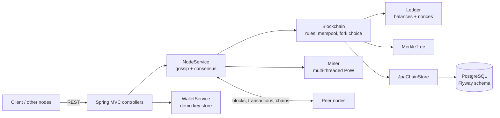

# ChainLedger

A proof-of-work blockchain node written in **Java 21 and Spring Boot**: signed transactions, Merkle proofs,
parallel mining, multi-node consensus over REST, and **PostgreSQL** persistence that is revalidated on every start.

Built to understand how a blockchain actually works by implementing each rule and testing the attack it stops.

## What it does

| Feature | How |
|---|---|
| **Wallets and signatures** | ECDSA key pairs (NIST P-256). An address is the first 40 hex characters of SHA-256(public key), so nobody can spend from an address without its private key. |
| **Double-spend and replay protection** | Account model with a per-sender nonce. A second spend of the same balance, a re-sent old transaction, and a transfer that overdraws the pending balance are all rejected. |
| **Blocks and proof-of-work** | SHA-256 over the block header; the hash must start with *N* zero bits. Difficulty is in bits, so each step doubles the work. |
| **Merkle tree** | Each block commits to its transactions through a Merkle root. `GET /api/transactions/{id}/proof` returns an inclusion proof of about log2(n) hashes that anyone can check against the block header. |
| **Parallel mining** | The nonce space is interleaved across threads; the first thread to find a valid hash stops the others. 8.5x faster on 12 cores ([benchmarks](docs/benchmarks.md)). |
| **Difficulty adjustment** | Every 10 blocks, difficulty rises a bit if blocks came more than twice as fast as the target and falls a bit if more than twice as slow. |
| **Multi-node consensus** | Nodes gossip transactions and blocks to their peers. A node that receives a block it cannot attach pulls its peers' chains and keeps the one with the most total work that passes full validation. Transactions from abandoned blocks go back into the mempool if still valid. |
| **Tamper detection** | Validation replays the chain from genesis and names the first bad block and the reason. Editing a stored transaction directly in PostgreSQL makes the node refuse to start, pointing at the edited block. |
| **PostgreSQL persistence** | Spring Data JPA (Hibernate) with a Flyway migration; each block and its transactions are written in one database transaction. Address history is served from indexed tables. |

## Architecture



The `core` and `crypto` packages are plain Java with no Spring dependency; Spring wires them to HTTP and the
database in `node`. Every public method on `Blockchain` is synchronized, so request threads, the miner and peer
sync always see a consistent chain.

## Consensus rules (checked for every block)

1. Index and previous hash link to the block before it; the timestamp does not go backwards.
2. Difficulty equals what the adjustment rule requires at that height.
3. The stored hash equals the hash of the header, and meets the proof-of-work target.
4. The Merkle root matches the transactions.
5. The first transaction is the only coinbase, carries the block height, and pays exactly reward plus fees.
6. Every other transaction is signed by the key behind its sender address, uses the sender's next nonce, and is
   covered by the sender's balance at that point in the block.

## Quick start

**Local** (needs Java 21, Maven and PostgreSQL):

```bash
createdb chainledger
mvn spring-boot:run
```

**Three nodes with Docker** (one PostgreSQL server, a database per node):

```bash
docker compose up --build
```

**Try it:**

```bash
B=localhost:8081/api
ALICE=$(curl -s -X POST $B/wallets | jq -r .address)
BOB=$(curl -s -X POST $B/wallets | jq -r .address)
curl -s -X POST $B/mine -H 'content-type: application/json' -d "{\"minerAddress\":\"$ALICE\"}"
curl -s -X POST $B/wallets/$ALICE/transfers -H 'content-type: application/json' \
     -d "{\"to\":\"$BOB\",\"amount\":20,\"fee\":2}"
curl -s -X POST $B/mine -H 'content-type: application/json' -d "{\"minerAddress\":\"$ALICE\"}"
curl -s localhost:8082/api/addresses/$BOB           # node 2 agrees: balance 20
curl -s -X POST $B/chain/tamper-check -H 'content-type: application/json' \
     -d '{"blockIndex":2,"transactionIndex":1,"newAmount":9999}'
# {"valid":false,"firstInvalidBlock":2,"reason":"transaction 1 invalid: id does not match contents"}
```

## API

| Method | Path | Purpose |
|---|---|---|
| GET | `/api/chain` | Height, tip, difficulty, total work, supply, mempool size |
| GET | `/api/chain/blocks` | Full chain (what peers download during consensus) |
| GET | `/api/blocks/{index}` | One block |
| GET | `/api/chain/audit` | Revalidate the whole chain from genesis |
| POST | `/api/chain/tamper-check` | Edit a past transaction in a copy of the chain and report where validation breaks |
| POST | `/api/mine` | Mine a block; returns hashes tried, time and hash rate |
| POST | `/api/transactions` | Submit a transaction signed anywhere (202 new, 200 known, 400 invalid with reason) |
| GET | `/api/transactions/pending` | Mempool |
| GET | `/api/transactions/{id}/proof` | Merkle inclusion proof |
| POST | `/api/wallets` | Create a demo wallet whose key stays on the node |
| POST | `/api/wallets/{address}/transfers` | Sign and submit a transfer from a demo wallet |
| GET | `/api/addresses/{address}` | Balance and next nonce |
| GET | `/api/addresses/{address}/transactions` | Confirmed history (PostgreSQL) |
| GET/POST | `/api/peers` | List or add peers (adding one syncs immediately) |
| POST | `/api/blocks` | Receive a block from a peer |
| POST | `/api/consensus` | Pull peers' chains and adopt the heaviest valid one |

Errors come back as RFC 9457 problem details, for example
`{"status":400,"detail":"insufficient funds: balance 28, needs 41"}`.

## Tests

`mvn verify` runs **43 tests** (39 unit, 4 integration) with **86% line coverage** (JaCoCo):

- **Unit (JUnit 5, AssertJ, Mockito):** Merkle proofs for 1 to 1,000 leaves; forged amounts, swapped signatures
  and spoofed senders; double spends, overdrafts, replays and overpaying coinbases; blocks without valid
  proof-of-work; tampering pinned to the exact block, including a re-mined block that breaks the next link;
  fork choice by total work and rejection of a longer but invalid chain; difficulty moving up and down;
  the miner at 1, 2, 4 and 8 threads; node decisions with the chain and miner mocked.
- **Integration (real PostgreSQL, real HTTP):** three nodes on random ports gossip a transfer, agree on every
  balance after a block mined elsewhere, and a fourth node with more work wins when it joins. Restarting a node
  rebuilds the same chain and balances from PostgreSQL; editing a transaction in the database is caught on startup.

GitHub Actions runs the full suite against a PostgreSQL 17 service container, publishes the coverage report,
validates the compose file and builds the Docker image.

## Limits (on purpose)

- Demo wallets keep private keys on the node so the API can sign for you; real clients should sign locally and
  use `POST /api/transactions`, which the node also accepts.
- P-256 instead of Bitcoin's secp256k1, because the JDK ships P-256.
- Peers are trusted URLs with no authentication or rate limiting, and the mempool is not persisted.
- Fork choice downloads whole chains; a production node would sync headers first.

## Tech

Java 21 · Spring Boot 4.2 (Web MVC, Data JPA, Validation, Actuator) · Hibernate · Flyway · PostgreSQL 17 ·
Maven · JUnit 5 · Mockito · AssertJ · JaCoCo · Docker · GitHub Actions
